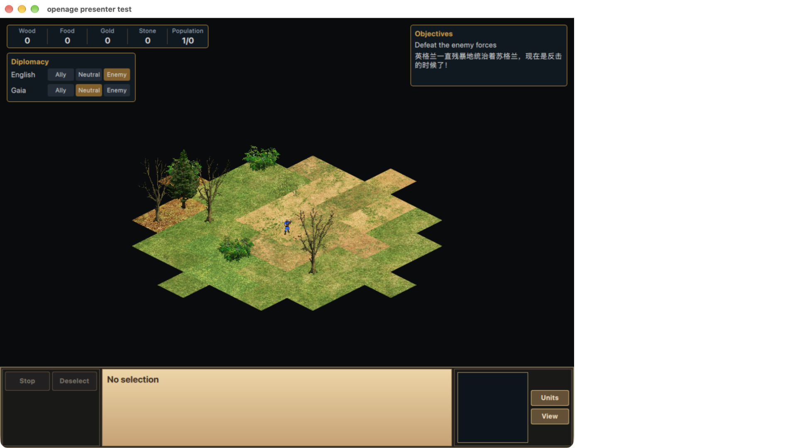
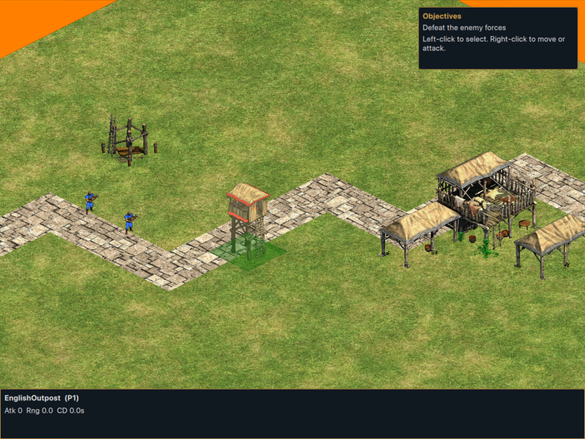
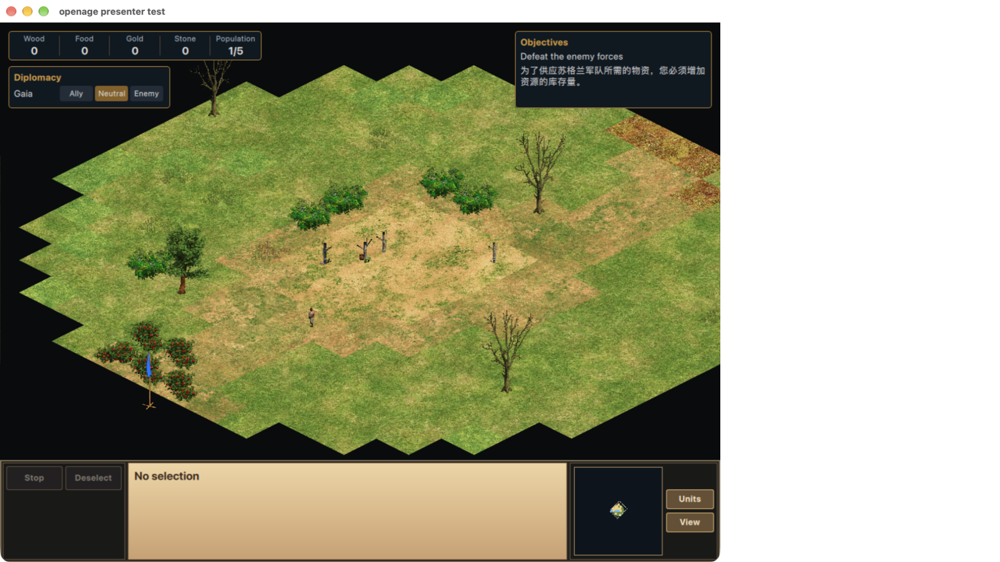
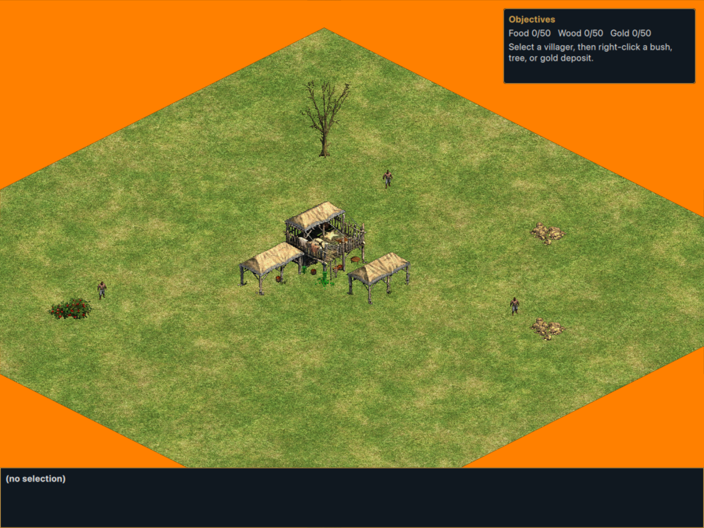

[](http://openage.dev)
=========================================================

> **Fork 说明**：本仓库基于上游 [SFTtech/openage](https://github.com/SFTtech/openage) 进行扩展开发。原版 README 已归档至 **[README.upstream.md](README.upstream.md)**。

---

## 本版本与上游原版（SFTtech/openage）的核心区别

在上游原版 `SFTtech/openage` 中，引擎正处于底层架构重写阶段，**尚不具备可玩性**（官方 README 标注 *"At the moment, 'gameplay' is basically non-functional"*）。

**本仓库在此基础上打通了完整的端到端 RTS 玩法闭环，支持直接加载并游玩《帝国时代 II：决定版》（AoE2: DE）原版威廉·华莱士（William Wallace）教学战役系列（Mission 1 & Mission 2），实现了初步完整可玩性：**

| 模块 | 上游原版 `SFTtech/openage` | 本仓库（Playable William Wallace Fork） |
| :--- | :--- | :--- |
| **战役与关卡加载** | 仅支持底层测试场景，无法加载原版战役 | 支持直接解包并导入 DE2 原版 `cam1.aoe2campaign(.gpv)` 中的 **`1_Wallace_1.aoe2scenario`**（120×120 地图、5,698 个实体、31 个触发器）与 **`1_Wallace_2.aoe2scenario`**（120×120 地图、10,130 个实体、27 个触发器），同时提供轻量 16×16 教学关卡与桌面战役启动器 |
| **触发器运行时（Trigger Runtime）** | 无完整场景触发器执行链路 | 完整实现事件驱动触发器运行时与原版 AoE2 条件/效果执行器（定时触发、区域检测、强制科技研发、动态刷兵增援、旗帜推进、大地之母村庄接管、英军反击与延时胜利链） |
| **战斗与寻路系统** | 仅有基础移动演示，无完整战斗闭环 | 实现基于静态/动态碰撞网格（Static & Dynamic Occupancy）的 A* 寻路、多单位编队移动、近战索敌接近（Attack Approach）、按原版护甲/攻击类别结算伤害、建筑三阶段起火受损特效与死亡移除 |
| **经济与城镇中心技能** | 无资源采集、建造、训练与科技研发 | 实现村民采集（浆果、伐木、采金、狩猎鹿/野猪、岸边捕鱼）、村民建造建筑（房屋、兵营、采矿场等，支持地基阶段与暂停/继续建造）、城镇中心训练村民与科技研发（如织布机 `Loom`、封建时代 `Feudal Age`），并遵循原版关卡禁用限制 |
| **视野、迷雾与 HUD** | 无战争迷雾、小地图与战役 HUD | 实现三态战争迷雾（未探索 / 已探索 / 可见）、外交关系与盟友视野共享、精灵级点选与框选高亮、小地图、资源/人口顶栏、目标面板与单位命令面板 |
| **全文明科技树导出** | 未导出完整文明科技树目录 | 支持从本机 DE2 `empires2_x2_p1.dat` 流式导出全部文明、单位、建筑与科技依赖图（`scripts/export_tech_trees.py`） |

---

## 真机运行截图（Mission 1 & Mission 2）

### Mission 1 · 行军与战斗（Marching and Fighting）

#### 1. 原版 120×120 完整场景加载与触发器流程（`1_Wallace_1.aoe2scenario`）


#### 2. 行军路线、战争迷雾、外交控制与小地图


#### 3. 摧毁英军前哨（原版三阶段火焰受损特效）与施工地基


---

### Mission 2 · 供养军队（Feeding the Army）

#### 1. 原版 120×120 完整场景与资源采集教学（`1_Wallace_2.aoe2scenario`）


#### 2. 村民采集（食物 / 木材 / 黄金）、城镇中心生产与库存目标统计


---

## 快速开始：直接运行 William Wallace 战役系列

### 1. 编译项目
安装依赖（参见 [doc/building.md](doc/building.md)），然后构建：

```bash
./configure --download-nyan
cmake --build bin -j8
```

### 2. 启动桌面战役选择器
在仓库根目录下直接运行：

```bash
bash scripts/run_campaign.sh
```

也可以通过命令行直接指定关卡启动：

```bash
# 启动第 1 关：Marching and Fighting（检测到本机 AoE2:DE 时自动加载原版 120x120 场景）
./venv/bin/python3 scripts/campaign_launcher.py --mode marching

# 启动第 2 关：Feeding the Army（检测到本机 AoE2:DE 时自动加载原版 120x120 场景）
./venv/bin/python3 scripts/campaign_launcher.py --mode feeding

# 启动第 1 关原版存档地形预览
./venv/bin/python3 scripts/campaign_launcher.py --mode terrain
```

### 3. 手动提取与安装原版战役场景（可选）
如果本机安装了 Steam 版《Age of Empires II: Definitive Edition》，可以单独运行导出脚本与安装脚本：

```bash
# 1. 导出全文明科技树与图形目录
./venv/bin/python3 scripts/export_tech_trees.py

# 2. 从本机 cam1.aoe2campaign(.gpv) 解包提取原版第 1、2 关
./venv/bin/python3 scripts/export_wallace_scenarios.py

# 3. 安装原版第 1 关或第 2 关并启动窗口
bash assets/nyan/ww_mvp/install.sh --original-scenario logs/wallace-original/mission-1.json "$HOME/Library/Application Support/Steam/steamapps/common/AoE2DE/AgeOfEmpires2Data"
bash scripts/run_ww_mission1.sh
```

### 4. 运行自动化回归验证

```bash
# 原版第 1 关 / 第 2 关完整战役流程无头回归测试
./bin/run test -d gamestate.tests.simulation_demo 53

# 35 项核心玩法与寻路/战斗/HUD 回归测试套件
bash scripts/p4_4d_regression.sh --regression

# Python 场景 IR / 转换器 / 科技树单元测试
./venv/bin/pytest openage/scenario/tests scripts/tests
```

---

## 上游项目文档与许可证

- 上游原始说明文档：**[README.upstream.md](README.upstream.md)**
- 构建与依赖指南：**[doc/building.md](doc/building.md)**
- 许可证：**GNU GPLv3** or later（详见 [copying.md](copying.md) 与 [legal/GPLv3](legal/GPLv3)）
