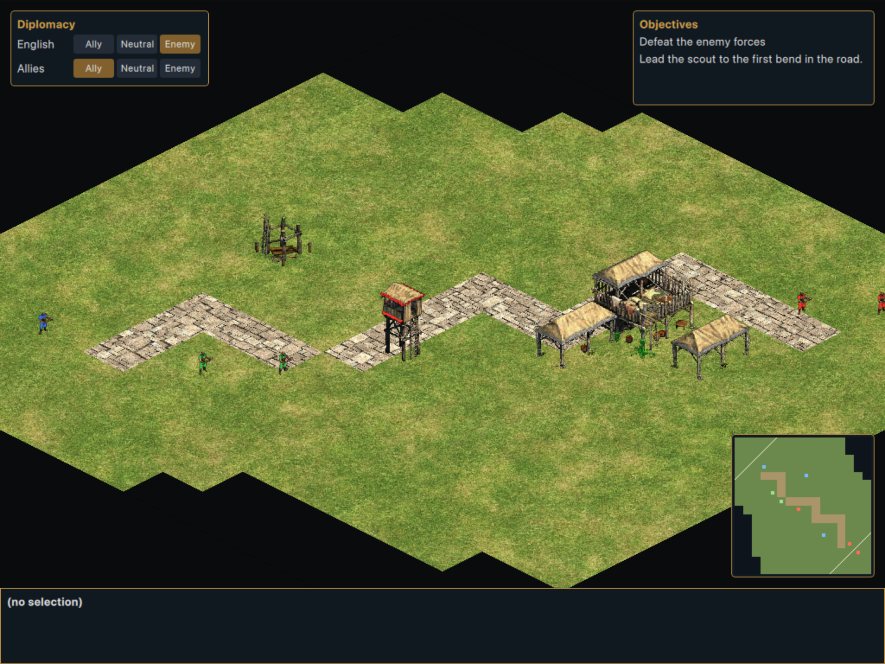

[](http://openage.dev)
=========================================================

# openage-plus

> **`openage-plus = openage + playable function helpers`**
>
> **Language**: **English** | [简体中文 (README.zh-CN.md)](README.zh-CN.md)
> **Detailed Architecture & Release Roadmap**: **[README-PLUS.md (English)](README-PLUS.md)** | **[README-PLUS.zh-CN.md (简体中文)](README-PLUS.zh-CN.md)**
> **Upstream Original README**: **[README.upstream.md](README.upstream.md)**

**`openage-plus`** is a playable-focused fork of [SFTtech/openage](https://github.com/SFTtech/openage). While upstream `openage` is currently undergoing a low-level engine rewrite where gameplay is non-functional, **`openage-plus` adds the missing playable function helpers**—bringing end-to-end RTS gameplay and allowing you to directly load and play the original *Age of Empires II: Definitive Edition* **William Wallace Learning Campaign (Mission 1 & Mission 2)**.

---

## 1. Key Differences: `openage-plus` vs. Upstream `SFTtech/openage`

| Subsystem | Upstream `SFTtech/openage` | `openage-plus` (`openage + playable function helpers`) |
| :--- | :--- | :--- |
| **Campaign & Scenario Loading** | Low-level engine demo scenes only; cannot load original campaigns | Unpacks DE2 `cam1.aoe2campaign(.gpv)` and natively runs **`1_Wallace_1.aoe2scenario`** (120×120 map, 5,698 entities, 31 triggers) and **`1_Wallace_2.aoe2scenario`** (120×120 map, 10,130 entities, 27 triggers), plus 16×16 fast tutorial packs and a desktop Campaign Launcher |
| **Trigger Runtime** | No scenario trigger runtime | Full event-driven `TriggerRuntime` + `OriginalScenario` executor supporting AoE2 conditions & effects (timers, area detection, forced tech research, dynamic unit spawning, waypoint advancement, Gaia village ownership transfer, English counter-attack, and delayed victory chains) |
| **Pathfinding, Collision & Combat** | Basic grid pathfinding demo; no combat loop | `StaticOccupancyGrid` + `DynamicOccupancy` + `SweptAABB` + `MovementReservation` + `FormationPlanner` for multi-unit group movement, `AttackApproach` (with 2D elevation-aware reach), armor/attack class discrete damage calculation, 3-stage building fire damage sprites, and event-driven death/removal |
| **Economy & Town Center Actions** | No gathering, building, training, or research | Villager resource gathering (forage bushes, woodcutting, gold mining, hunting deer/boar, shore fishing), building construction (foundation -> progress -> completion, pause/resume), Town Center villager training & tech research (`Loom`, `Feudal Age`), and per-scenario restriction enforcement |
| **Fog of War, Input & HUD** | No fog of war, minimap, or gameplay HUD | 3-state Fog of War (Unexplored / Explored / Visible), ally shared vision, diplomacy switching, right-click `ContextActionResolver`, sprite-level picking & box-selection footprint highlights, minimap, resource/population top bar, objectives panel, and command panel (`MissionHud.qml`) |
| **Full Tech Tree Exporter** | Not available | Streaming extractor (`scripts/export_tech_trees.py`) for all civilizations, units, buildings, and tech dependency graphs from `empires2_x2_p1.dat` |

---

## 2. Summary of Architectural Additions & Modified Logic

For a comprehensive deep dive into every new module and core engine change, see **[README-PLUS.md](README-PLUS.md)** (or **[README-PLUS.zh-CN.md](README-PLUS.zh-CN.md)**).

- **New Modules Added**:
  - **Scenario Compiler & Pack Pipeline (`openage/scenario/`, `assets/nyan/ww_mvp/`)**: Normalizes `.aoe2scenario` data into `ScenarioIR`, validates `nyan` cross-references, auto-converts missing SLD tree/cliff sprites on the fly, and emits deterministic Mission Packs.
  - **Native Scenario & Trigger Subsystem (`libopenage/scenario/`)**: C++ `MissionPackReader`, event-driven `TriggerRuntime`, `OriginalScenario` trigger engine, `FeedingTheArmy` economy tracker, `OutpostFire` 3-stage fire controller, and `ShoreFishing`.
  - **Tactical Movement & Occupancy (`libopenage/pathfinding/`)**: `DynamicOccupancy`, `SweptAABB`, `MovementReservationManager`, `FormationPlanner`, and `AttackApproach`.
  - **Context Input & QML HUD (`libopenage/input/`, `libopenage/presenter/hud/`, `assets/qml/MissionHud.qml`)**: Semantic right-click action resolver, `SelectionModel`, world-space `SelectionOverlay`, and reactive QtQuick HUD.
- **Core Engine Logic Modified**:
  - **DE2 Converter Compatibility (`openage/convert/`)**: Added versioned layout profiles (DE2 8.4 / 8.9) and on-demand media export filtering.
  - **Deterministic Simulation & Combat Lifecycle (`libopenage/event/`, `libopenage/gamestate/`)**: Deterministic equal-time event ordering, armor-class discrete damage calculation, deferred removal via `EventLoop`, footprint-filtered dynamic occupancy registration (so grass decals and flags do not block roads), and safe handling of invisible scenario helper entities (`Idle::idle`).
  - **Renderer & Camera (`libopenage/renderer/`, `libopenage/presenter/`)**: Tolerant `.sprite` empty-angle parsing, Fog of War / health bar / construction bar shaders, and smart initial camera centering on player controllable units/buildings.

---

## 3. Real Desktop Screenshots (Mission 1 & Mission 2)

### Mission 1 · Marching and Fighting

#### 1. Original 120×120 Scenario Loaded with Live Trigger Chain (`1_Wallace_1.aoe2scenario`)


#### 2. Marching Route, Fog of War, Diplomacy Control, and Minimap


#### 3. Destroying the English Outpost (3-Stage Fire Damage Sprites) & Construction Foundations


---

### Mission 2 · Feeding the Army

#### 1. Original 120×120 Scenario & Resource Gathering Tutorial (`1_Wallace_2.aoe2scenario`)


#### 2. Villager Gathering (Food / Wood / Gold), Town Center Production, and Stockpile Objectives


---

## 4. Quick Start: Run the William Wallace Campaign

### 1. Build `openage-plus`
Install dependencies (see [doc/building.md](doc/building.md)), then configure and build:

```bash
./configure --download-nyan
cmake --build bin -j8
```

### 2. Launch the Desktop Campaign Selector
From the repository root:

```bash
bash scripts/run_campaign.sh
```

Or launch a specific mission directly via CLI:

```bash
# Mission 1: Marching and Fighting (auto-loads the 120x120 original scenario if AoE2:DE is installed)
./venv/bin/python3 scripts/campaign_launcher.py --mode marching

# Mission 2: Feeding the Army (auto-loads the 120x120 original scenario if AoE2:DE is installed)
./venv/bin/python3 scripts/campaign_launcher.py --mode feeding

# Mission 1 Original Save Terrain Preview
./venv/bin/python3 scripts/campaign_launcher.py --mode terrain
```

### 3. Manually Extract & Install Original Scenarios (Optional)
If you have Steam *Age of Empires II: Definitive Edition* installed locally:

```bash
# 1. Export full civilization tech trees and graphics catalog
./venv/bin/python3 scripts/export_tech_trees.py

# 2. Extract 1_Wallace_1.aoe2scenario & 1_Wallace_2.aoe2scenario from cam1.aoe2campaign(.gpv)
./venv/bin/python3 scripts/export_wallace_scenarios.py

# 3. Install original Mission 1 or Mission 2 and launch window
bash assets/nyan/ww_mvp/install.sh --original-scenario logs/wallace-original/mission-1.json "$HOME/Library/Application Support/Steam/steamapps/common/AoE2DE/AgeOfEmpires2Data"
bash scripts/run_ww_mission1.sh
```

### 4. Run Automated Regression Tests

```bash
# Headless end-to-end verification for original Mission 1 & Mission 2
./bin/run test -d gamestate.tests.simulation_demo 53

# 35-demo core gameplay, pathfinding, combat, and HUD regression suite
bash scripts/p4_4d_regression.sh --regression

# Python scenario IR, converter, and tech tree unit tests (129 tests)
./venv/bin/pytest openage/scenario/tests scripts/tests
```

---

## 5. Cross-Platform Release Roadmap (Linux / Windows / macOS)

To enable out-of-the-box play on **Linux, Windows, and macOS** without redistributing proprietary AoE2:DE assets or requiring command-line setup, `openage-plus` is designed around a **3-in-1 release bundle**:

1. **Game Core Binary (`openage-plus` Core)**: Prebuilt C++20/Qt6/OpenGL engine + embedded Python runtime + built-in `nyan` gameplay schemas and shaders.
2. **Visual Converter Wizard (Converter GUI)**: Auto-detects local Steam AoE2:DE paths across Windows Registry, macOS `Application Support`, and Linux Steam/Proton directories; offers a **Fast Campaign Conversion Mode (~30–60s)** using on-demand media filtering as well as full background conversion with a visual progress bar.
3. **Campaign Launcher GUI**: Unified desktop launcher that checks converted asset status, triggers the Converter GUI on first run, and lets players launch William Wallace missions with one click.

See **[README-PLUS.md §6](README-PLUS.md#6-cross-platform-release--packaging-roadmap-linux--windows--macos)** for the full packaging architecture.

---

## 6. Links & License

- **Detailed Architecture & Diff vs. Upstream**: [README-PLUS.md](README-PLUS.md) | [README-PLUS.zh-CN.md](README-PLUS.zh-CN.md)
- **Chinese README**: [README.zh-CN.md](README.zh-CN.md)
- **Upstream Original README**: [README.upstream.md](README.upstream.md)
- **Build & Dependency Guide**: [doc/building.md](doc/building.md)
- **License**: **GNU GPLv3** or later (see [copying.md](copying.md) and [legal/GPLv3](legal/GPLv3))
