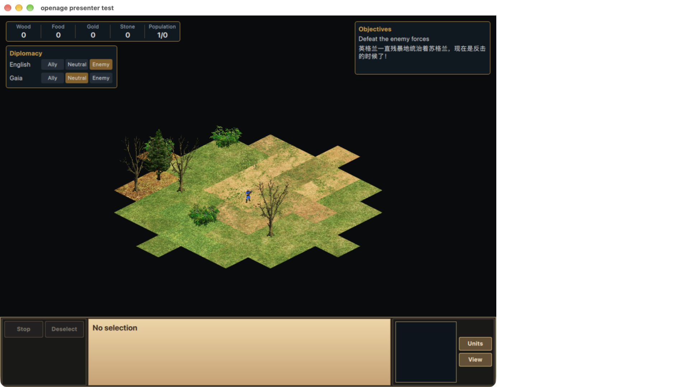
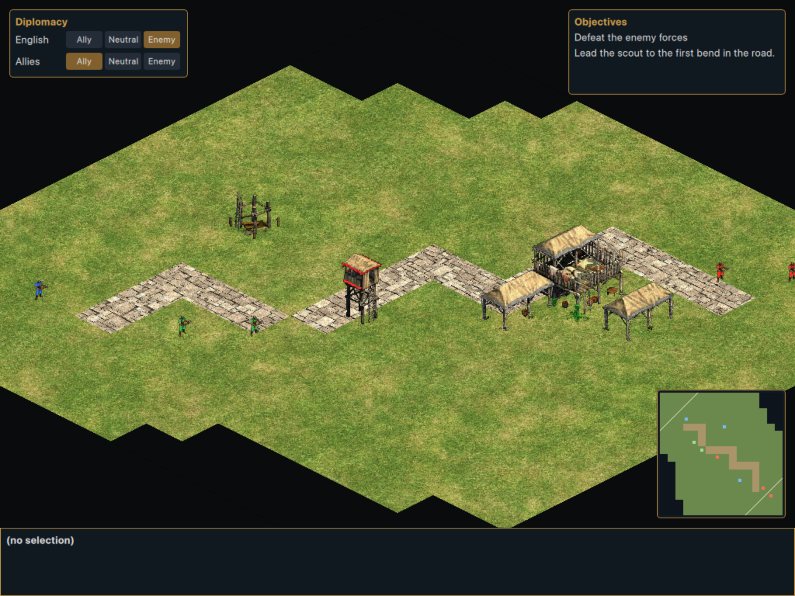
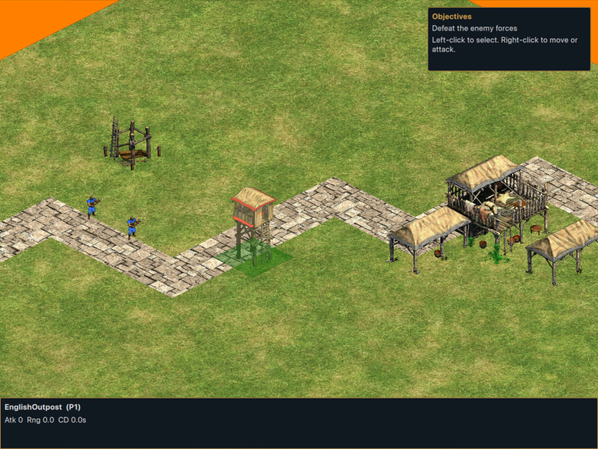
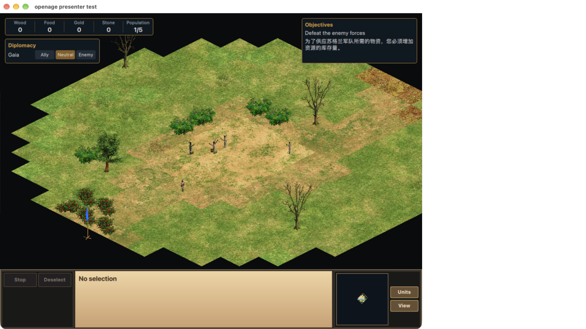
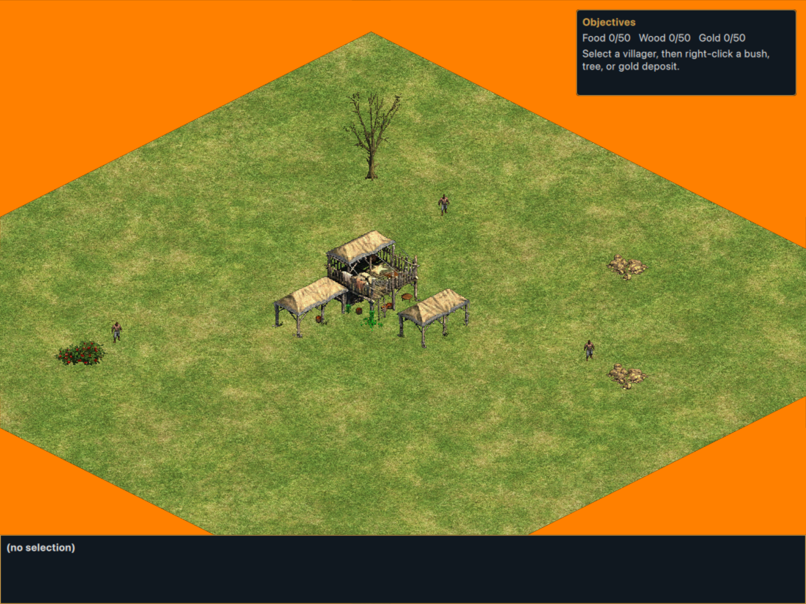

[](http://openage.dev)
=========================================================

# openage-plus

> **`openage-plus = openage + playable function helpers`**
>
> **语言 (Language)**: [English (README.md)](README.md) | **简体中文**
> **完整架构与跨平台发布方案**: **[README-PLUS.zh-CN.md (简体中文)](README-PLUS.zh-CN.md)** | **[README-PLUS.md (English)](README-PLUS.md)**
> **上游原版 README 归档**: **[README.upstream.md](README.upstream.md)**

**`openage-plus`** 是基于上游 [SFTtech/openage](https://github.com/SFTtech/openage) 扩展开发的**完整游戏可玩性分支**。在上游原版 `openage` 中，引擎正处于底层架构重写阶段，尚不具备游戏可玩性（官方标注 *"At the moment, 'gameplay' is basically non-functional"*）。

**`openage-plus` 在原版引擎基础上补齐了完整的 `playable function helpers`（可玩性功能模块），打通了端到端 RTS 玩法闭环，支持直接加载并游玩《帝国时代 II：决定版》（AoE2: DE）原版威廉·华莱士（William Wallace）教学战役系列（Mission 1 & Mission 2）。**

---

## 1. `openage-plus` 与上游原版 `SFTtech/openage` 的核心区别

| 模块 | 上游原版 `SFTtech/openage` | `openage-plus`（`openage + playable function helpers`） |
| :--- | :--- | :--- |
| **战役与关卡加载** | 仅支持底层测试场景，无法加载原版战役 | 支持直接解包并导入 DE2 原版 `cam1.aoe2campaign(.gpv)` 中的 **`1_Wallace_1.aoe2scenario`**（120×120 地图、5,698 个实体、31 个触发器）与 **`1_Wallace_2.aoe2scenario`**（120×120 地图、10,130 个实体、27 个触发器），同时提供轻量 16×16 教学关卡与桌面战役启动器 |
| **触发器运行时（Trigger Runtime）** | 无完整场景触发器执行链路 | 完整实现事件驱动触发器运行时与原版 AoE2 条件/效果执行器（定时触发、区域检测、强制科技研发、动态刷兵增援、旗帜推进、大地之母村庄接管、英军反击与延时胜利链） |
| **战斗与寻路系统** | 仅有基础移动演示，无完整战斗闭环 | 实现基于静态/动态碰撞网格（Static & Dynamic Occupancy）的 A* 寻路、Swept AABB 连续碰撞检测、多单位编队移动（`FormationPlanner`）、近战索敌接近（`AttackApproach`，兼容高地 2D 距离）、按原版护甲/攻击类别结算伤害、建筑三阶段起火受损特效与事件驱动死亡移除 |
| **经济与城镇中心技能** | 无资源采集、建造、训练与科技研发 | 实现村民采集（浆果、伐木、采金、狩猎鹿/野猪、岸边捕鱼）、村民建造建筑（房屋、兵营、采矿场等，支持地基阶段与暂停/继续建造）、城镇中心训练村民与科技研发（如织布机 `Loom`、封建时代 `Feudal Age`），并严格遵循原版关卡禁用限制 |
| **视野、迷雾与 HUD** | 无战争迷雾、小地图与战役 HUD | 实现三态战争迷雾（未探索 / 已探索 / 可见）、外交关系与盟友视野共享、右键语义动作解析器（`ContextActionResolver`）、精灵级点选与框选脚印高亮、小地图、资源/人口顶栏、目标面板与单位命令面板（`MissionHud.qml`） |
| **全文明科技树导出** | 未导出完整文明科技树目录 | 支持从本机 DE2 `empires2_x2_p1.dat` 流式导出全部文明、单位、建筑与科技依赖图（`scripts/export_tech_trees.py`） |

---

## 2. 整体修改点概要（模块新增与核心逻辑修改）

深入浅出的完整架构解析、模块清单与跨平台发布方案请参阅 **[README-PLUS.zh-CN.md](README-PLUS.zh-CN.md)**（英文版：**[README-PLUS.md](README-PLUS.md)**）。

- **新增核心模块**：
  - **场景编译与原版战役转换管线（`openage/scenario/`、`assets/nyan/ww_mvp/`）**：将 `.aoe2scenario` 标准化为 `ScenarioIR`，校验 `nyan` 引用完整性，对缺失预生成精灵的树木/悬崖自动从 `.sld` 即时转换，并输出确定性 Mission Pack。
  - **C++ 原生场景与触发器子系统（`libopenage/scenario/`）**：包含 `MissionPackReader`、事件驱动 `TriggerRuntime`、原版触发器执行器 `OriginalScenario`、第二关经济控制器 `FeedingTheArmy`、建筑三阶段火焰控制器 `OutpostFire` 及岸边捕鱼 `ShoreFishing`。
  - **战术寻路与空间碰撞子系统（`libopenage/pathfinding/`）**：包含 `DynamicOccupancy`、`SweptAABB`、`MovementReservationManager`、`FormationPlanner` 与 `AttackApproach`。
  - **上下文输入与 QML 战役 HUD（`libopenage/input/`、`libopenage/presenter/hud/`、`assets/qml/MissionHud.qml`）**：实现右键语义分发、多单位选择模型、世界空间脚印高亮与 QtQuick 响应式 HUD。
- **核心引擎逻辑修改**：
  - **DE2 转换器多版本兼容（`openage/convert/`）**：新增 DE2 8.4 / 8.9 版本化 `dat` 布局配置与按需媒体导出过滤器（`media_filter.py`）。
  - **确定性事件模拟与战斗生命周期（`libopenage/event/`、`libopenage/gamestate/`）**：修复同刻事件顺序不确定性、实现护甲相克离散伤害结算、通过 `EventLoop` 延迟移除死亡实体、过滤无物理占地装饰物（草丛/旗帜）的动态碰撞注册，并兼容无 `Idle` 组件的原版隐藏触发对象。
  - **渲染器容错与镜头聚焦（`libopenage/renderer/`、`libopenage/presenter/`）**：过滤 `.sprite` 文件中的无帧空角度定义、集成战争迷雾/血条/施工进度着色器，并将初始镜头智能聚焦于玩家可控单位或建筑。

---

## 3. 真机运行截图（Mission 1 & Mission 2）

### Mission 1 · 行军与战斗（Marching and Fighting）

#### 1. 原版 120×120 完整场景加载与触发器流程（`1_Wallace_1.aoe2scenario`）


#### 2. 行军路线、战争迷雾、外交控制与小地图


#### 3. 摧毁英军前哨（原版三阶段火焰受损特效）与施工地基


---

### Mission 2 · 供养军队（Feeding the Army）

#### 1. 原版 120×120 完整场景与资源采集教学（`1_Wallace_2.aoe2scenario`）


#### 2. 村民采集（食物 / 木材 / 黄金）、城镇中心生产与库存目标统计


---

## 4. 快速开始：直接运行 William Wallace 战役系列

### 1. 编译项目
安装依赖（参见 [doc/building.md](doc/building.md)），然后构建：

```bash
./configure --download-nyan
cmake --build bin -j8
```

### 2. 启动桌面战役选择器
在仓库根目录下直接运行：

```bash
bash scripts/run_campaign.sh
```

也可以通过命令行直接指定关卡启动：

```bash
# 启动第 1 关：Marching and Fighting（检测到本机 AoE2:DE 时自动加载原版 120x120 场景）
./venv/bin/python3 scripts/campaign_launcher.py --mode marching

# 启动第 2 关：Feeding the Army（检测到本机 AoE2:DE 时自动加载原版 120x120 场景）
./venv/bin/python3 scripts/campaign_launcher.py --mode feeding

# 启动第 1 关原版存档地形预览
./venv/bin/python3 scripts/campaign_launcher.py --mode terrain
```

### 3. 手动提取与安装原版战役场景（可选）
如果本机安装了 Steam 版《Age of Empires II: Definitive Edition》，可以单独运行导出脚本与安装脚本：

```bash
# 1. 导出全文明科技树与图形目录
./venv/bin/python3 scripts/export_tech_trees.py

# 2. 从本机 cam1.aoe2campaign(.gpv) 解包提取原版第 1、2 关
./venv/bin/python3 scripts/export_wallace_scenarios.py

# 3. 安装原版第 1 关或第 2 关并启动窗口
bash assets/nyan/ww_mvp/install.sh --original-scenario logs/wallace-original/mission-1.json "$HOME/Library/Application Support/Steam/steamapps/common/AoE2DE/AgeOfEmpires2Data"
bash scripts/run_ww_mission1.sh
```

### 4. 运行自动化回归验证

```bash
# 原版第 1 关 / 第 2 关完整战役流程无头回归测试
./bin/run test -d gamestate.tests.simulation_demo 53

# 35 项核心玩法与寻路/战斗/HUD 回归测试套件
bash scripts/p4_4d_regression.sh --regression

# Python 场景 IR / 转换器 / 科技树单元测试（129 项）
./venv/bin/pytest openage/scenario/tests scripts/tests
```

---

## 5. 跨平台（Linux / Windows / macOS）版本发布规划

为了让玩家在 **Linux、Windows、macOS** 上开箱即玩（无需违反版权分发原版资产，也无需手动敲命令行转换资产），`openage-plus` 采用**“游戏引擎本体 + Converter 可视化工具 + 桌面战役启动器”**三位一体的发行包设计：

1. **游戏引擎本体（`openage-plus` Core）**：预编译 C++20/Qt6/OpenGL 核心二进制 + 内嵌 Python 运行时 + 内置 `nyan` 战役逻辑模组。
2. **Converter 可视化工具（首次运行资产转换向导）**：自动探测三大平台的本地 Steam AoE2:DE 安装路径；提供 **快速战役转换模式（约 30~60 秒完成，基于按需媒体过滤）** 与后台全量转换模式，带可视化进度条与日志诊断。
3. **桌面战役启动器（Campaign Launcher GUI）**：启动时自动检查本地转换缓存，未转换时引导打开 Converter 可视化工具，转换完成后一键进入各战役关卡。

完整设计详见 **[README-PLUS.zh-CN.md §6](README-PLUS.zh-CN.md#6-跨平台linux--windows--macos发布与打包路线图)**。

### 面向 WASM 与小程序的 UI 设计原则

桌面端继续使用 Qt/QML，共享不依赖 Qt 的展示状态与语义操作，并复用现有指令和事件接口。
平台相关的绘制、输入、存储和资产访问留在适配层，按具体目标的实际需求增加实现。
客户端使用预转换且带版本信息的资产；小地图逐步建立通用数据边界，避免提前开发通用 UI 框架。
完整约束、当前实现边界、小地图方案与最小平台验证计划见 [UI 跨平台设计原则](doc/code/ui_portability.md)。

---

## 6. 相关文档与许可证

- **完整架构与修改详情**：[README-PLUS.zh-CN.md](README-PLUS.zh-CN.md) | [README-PLUS.md](README-PLUS.md)
- **英文版主 README**：[README.md](README.md)
- **上游原始说明文档**：[README.upstream.md](README.upstream.md)
- **构建与依赖指南**：[doc/building.md](doc/building.md)
- **许可证**：**GNU GPLv3** or later（详见 [copying.md](copying.md) 与 [legal/GPLv3](legal/GPLv3)）
